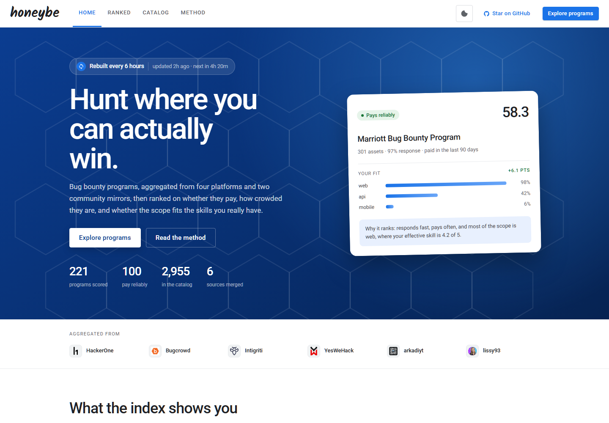
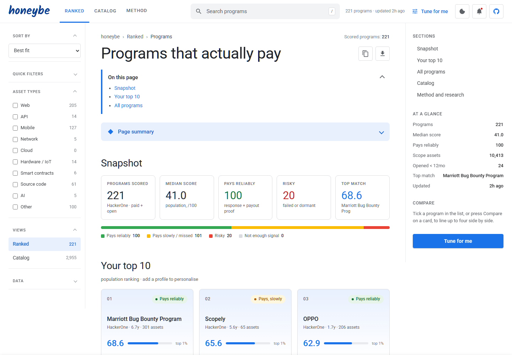
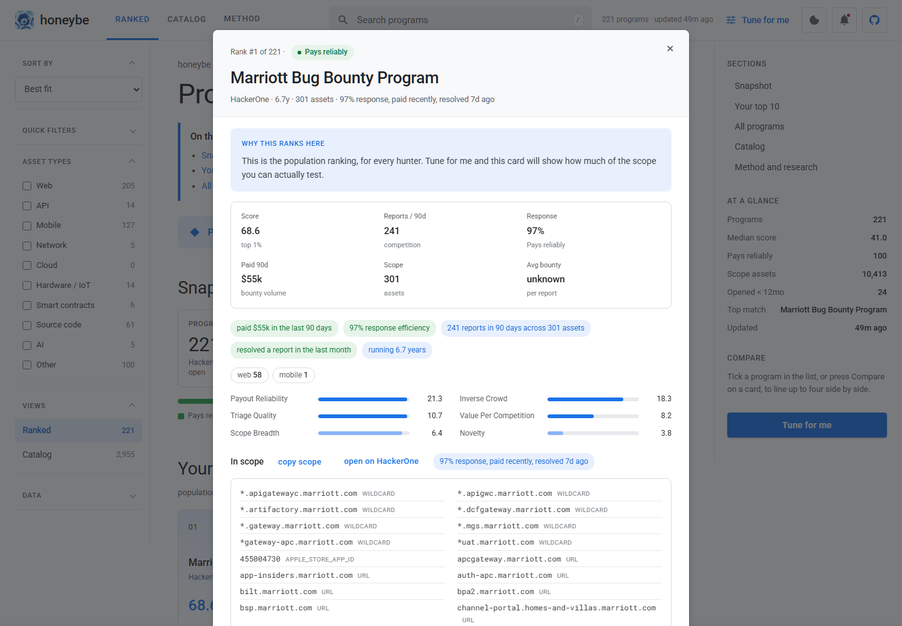
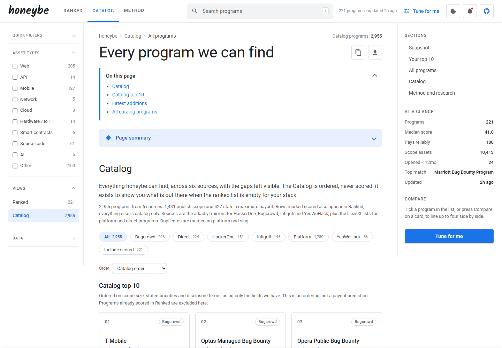
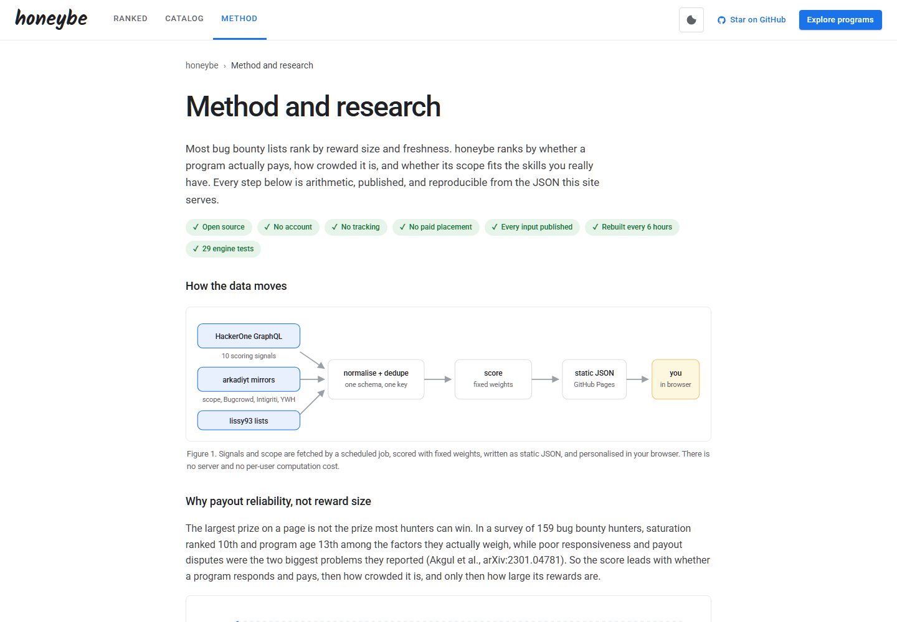
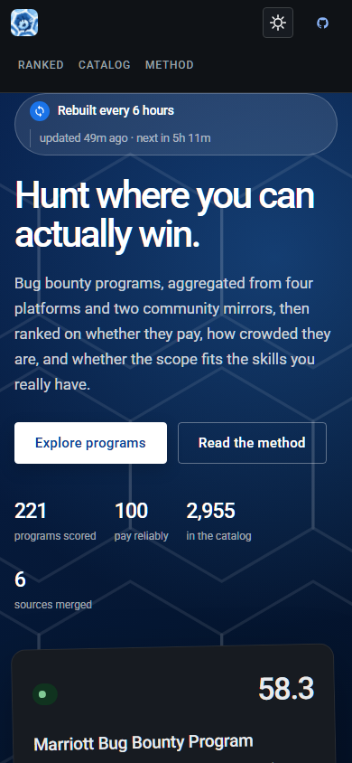

# honeybe

Bug bounty opportunity intelligence that ranks programs on whether they pay, how crowded they are, and whether the scope fits the skills you actually have.

honeybe collects bug bounty programs from four platforms and two community mirrors, scores the HackerOne set from public signals, and lets you personalize the order in your browser. It is a static site. A GitHub Actions job rebuilds it every six hours and GitHub Pages serves it. There are no accounts, no server, and no paid compute.

- Live site: https://honeybe.tech
- Repository: https://github.com/asucodes/honeybe
- Method and research: [public/method.html](public/method.html)
- Data guide for models and agents: [public/llms.txt](public/llms.txt)

## Screenshots

### Home



The home page explains what the index covers, where the data comes from, and which programs currently lead. The top five updates with every crawl.

### Ranked



The ranked view is the scored HackerOne set. It has search, quick filters, Will They Pay badges, coverage and confidence chips, asset-type filters, and a top ten board.

### Match card



Every ranked program opens a match card. It shows the six decision metrics, the score anatomy, the scope list, and the reasons behind the rank.

### Catalog



The catalog covers every program found, including programs from Bugcrowd, Intigriti, YesWeHack and direct company pages. Catalog rows are ordered but never scored.

### Method



The method page documents every signal, formula, penalty, bound and citation, plus the steps used to verify a score.

### Mobile



Dark mode on a small screen. The layout collapses to a single column and the asset filters become chips.

## Why this exists

Most program lists rank by reward size and freshness. Research on hunter behaviour points somewhere else. In a study of 159 hunters, saturation ranked 10th and program age ranked 13th in their own decisions, while the two biggest reported challenges were poor responsiveness and payout disputes. A separate study of 9,942 HackerOne reports found that reputation affected outcomes in near-identical pairs.

honeybe ranks on the things that decide whether a report is worth writing: whether the program pays reliably, how crowded the target is, how quickly it responds, and how much of the scope you can actually test. Every rank has a visible reason.

## What you get

- **A public score you can inspect.** Ten HackerOne signals are normalized and weighted, with the formula and the missing-data rules published.
- **A Will They Pay badge.** Payout reliability is separated from prize size, so a large maximum bounty does not hide a program that rarely pays.
- **A match card for every ranked program.** Surface share, effective skill, stack match, personal delta, score anatomy and the scope list.
- **Comparison.** Put up to four programs side by side on score, crowding, response, payout, age and slop risk, then export the comparison as CSV.
- **Asset-type filters.** Web, API, mobile, network, cloud, hardware and IoT, smart contracts, source code, AI and other. Checked types are OR-ed.
- **A full catalog.** Every program found, with coverage and confidence chips, platform filters, ordering and first-seen dates. Catalog rows are never scored.
- **A change feed.** Each crawl is diffed against the last snapshot: new scored programs, new catalog entries, new scope assets, changed scope and removed assets.
- **Open data.** The ranked set, the catalog and the change feed are published as JSON for notebooks, retrieval indexes and your own agents.

## How the ranking works

The public score blends ten HackerOne signals: payout reliability, report volume, response efficiency, average bounty, maximum bounty, scope breadth, asset diversity, age, policy quality and data quality. Each signal is normalized to a common scale before weighting. Missing fields reduce coverage instead of adding points.

Will They Pay is a separate badge. It classifies payout behaviour as reliable, slow, risky or unknown. A program with no payout evidence is not treated as generous.

Personalization runs entirely in the browser. It can move a program by at most 12 points, and the direction is monotonic: a better fit never lowers a program. Skill level adjusts how much influence personal fit has, from half weight for beginners to full weight for advanced hunters. The public score, the personal delta and the profile completeness are all shown.

Full formulas, penalties, bounds and verification steps are in [public/method.html](public/method.html) and [docs/SCORING.md](docs/SCORING.md).

## Data flow

```
HackerOne GraphQL ─┐
arkadiyt mirrors ──┼─→ normalize → score → public/data/*.json → GitHub Pages
lissy93 lists ─────┘                                  ↓
                                            browser personalization
```

The crawl runs from GitHub Actions every six hours. There is no database and no application server. The browser fetches static JSON and the personalization engine runs locally against localStorage.

## Sources and cadence

| Source | Used for |
|---|---|
| HackerOne GraphQL | The ten public scoring signals and the HackerOne scope set |
| arkadiyt/bounty-targets-data | Scope dumps for HackerOne, Bugcrowd, Intigriti and YesWeHack |
| lissy93/bug-bounties | Platform and direct program lists |
| Bugcrowd, Intigriti and YesWeHack dumps | Catalog coverage |

The source files are SHA-gated, so an unchanged upstream file does not trigger a full rebuild. Counts drift as programs open, close and change scope. The counts in this README are from the crawl on 20 October 2026: 221 scored programs, about 4,850 scope assets and 2,955 catalog programs.

## Run it locally

```bash
python -m pip install -r requirements.txt
python -m pipeline.run
python -m http.server 8765 -d public
```

Open http://localhost:8765.

The crawl writes to `public/data/`. It also updates the change feed in `public/data/events.json` and the snapshot in `data/cache/`, which is gitignored and restored by the workflow cache.

Checks:

```bash
node public/engine.test.js
node --check public/app.js
```

## Repository layout

```
pipeline/
  sources/hackerone.py   HackerOne GraphQL scoring signals
  sources/arkadiyt.py    scope dumps for four platforms
  sources/catalog.py     multi-platform catalog merge
  normalize.py           unified schema and conservative deduplication
  score.py               population-level scores
  badges.py              Will They Pay and the AI-slop proxy
  events.py              snapshot diff and change feed
  emit.py                writes public/data/*.json
public/
  index.html             home
  app.html               ranked view and catalog
  method.html            method and research
  app.js                 tabs, filters, tables, match cards, change feed
  home.js                live counts and top five on the home page
  page.js                live counts and coverage figures on the method page
  theme.js               light and dark theme
  engine.js              personalization engine, framework agnostic
  engine.test.js         assertion harness
  llms.txt               data guide for models and agents
  data/                  published JSON
docs/
  SCORING.md             formulas and research notes
  screenshots/           images used in this README
.github/workflows/
  crawl.yml              six-hour crawl
```

## Limits

- Only the HackerOne set is scored. Catalog rows from other platforms are ordered, not scored.
- Response and payout fields are optional upstream. Unknown is displayed as unknown and never as a good score.
- AI-slop detection is an experimental proxy. It is labelled as experimental in the interface.
- Deduplication is conservative. The same company can appear on two platforms rather than be merged incorrectly.
- The cron can drift by 5 to 15 minutes. Some sources publish on their own schedule.
- Scope coverage differs by platform. The catalog shows coverage per row instead of implying that every program has a complete scope list.

## Research

- Maillart et al., [Given Enough Eyeballs, All Bugs Are Shallow?](https://arxiv.org/abs/1608.03445) (arXiv:1608.03445). Bug-discovery probability decays as `t^-0.40` after launch.
- Akgul et al., [Bug Hunters' Perspectives](https://arxiv.org/abs/2301.04781) (arXiv:2301.04781). 159 hunters; saturation ranked 10th and age 13th, while responsiveness and payout disputes were the top two challenges.
- Zheng et al., [From Reviewers' Lens](https://arxiv.org/abs/2511.18608) (arXiv:2511.18608). 9,942 HackerOne reports; reputation affected outcomes in near-identical pairs.

## Contributing

Issues and pull requests are welcome. The pipeline is Python, the interface is plain HTML, CSS and JavaScript, and the personalization engine has a small assertion harness. If you change a scoring rule, update the method page and the tests in the same change.
